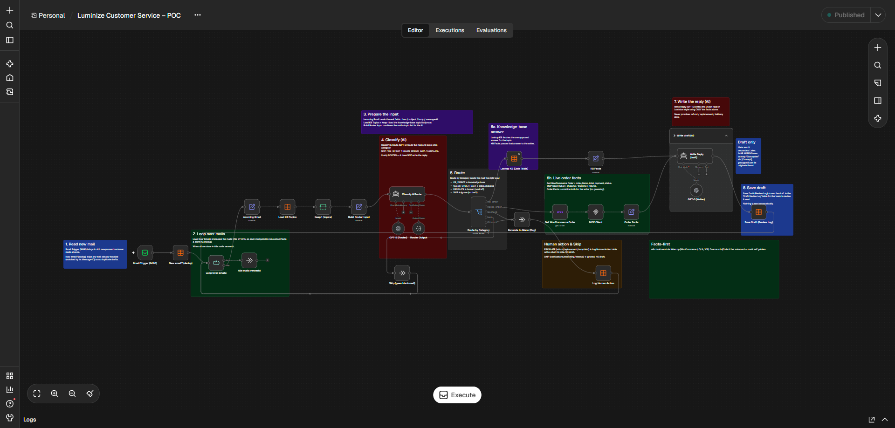

# Customer Support Agent — AI Email Automation (n8n + GPT-5)

An always-on AI agent that handles an e-commerce customer-service inbox. Every time a new customer email arrives, it reads it, fetches the real facts (order, shipping, knowledge base), writes a reply in the store's voice, and saves it as a **draft for a human to review**. Nothing is sent automatically.

Built for **Luminize** (lamps / lighting e-commerce, Netherlands) as a replacement for a manual ChatGPT setup that needed permission on every conversation and could not run on its own.



---

## What it does

- Reads new, unread customer emails from the support mailbox (IMAP, read-only).
- Classifies each mail with a GPT-5 **Router**.
- Pulls live facts from WooCommerce (orders) and QLS (shipping / tracking / returns) or from an approved knowledge base.
- Writes a Dutch reply (formal "u" form, time-based greeting) with a GPT-5 **Writer**, mirroring the customer's language when it is not Dutch.
- Saves the draft to a review table; risky mails go to a separate human-action queue.

## Core principles

1. **Facts first** — n8n fetches the real data before the AI writes anything. The AI uses only those facts and never invents order numbers, prices, tracking or refunds.
2. **Drafts only** — in Phase 1 a human reviews and sends every reply.
3. **No autonomous commitments** — no promises of refunds, replacements, exchanges, compensation, discounts or delivery dates. Those go to a human.
4. **Read-only mailbox** — mails are not marked as read, moved or deleted.
5. **Safety** — never tells a customer to change mains wiring; refers to a qualified installer.

## Architecture

```
New customer email
      │
[Email Trigger (IMAP)]       all new/unseen mails
      │
[New email? (dedup)]         skip anything already processed (Message-ID)
      │
[Loop Over Emails]           one mail at a time
      │
[Incoming Email] → [Load KB Topics] → [Build Router Input]
      │
[Classify & Route — GPT-5 Router]
      │
[Route by Category]
      ├─ KB_DIRECT         → Lookup KB ───────────────┐
      ├─ NEEDS_ORDER_DATA  → WooCommerce → QLS ───────┤→ [Write Reply — GPT-5 Writer] → [Save Draft]
      ├─ ESCALATE          → Human Action Log (no draft)
      ├─ SKIP              → ignored
      └─ fallback          → Human Action Log (safety)
```

## Router categories

| Category | Meaning | Result |
|---|---|---|
| `SKIP` | Not a real customer question: shop order notifications, automated/no-reply mail, newsletters, marketing, internal or supplier mail (contact-form submissions are *not* skipped) | Ignored, no draft |
| `ESCALATE` | Needs a human decision: complaints, legal threats, injury/fire, chargebacks, refunds, replacements, exchanges, compensation, discounts | Human Action Log with a short AI note, no draft |
| `KB_DIRECT` | General product / policy question answerable from the knowledge base | Draft |
| `NEEDS_ORDER_DATA` | Informational question about a specific order (status, payment, items, tracking) | Draft using live order data |

The router also returns: language, order number, intent, KB topic, a human-action note and its reasoning.

## Tech stack

- **n8n** (self-hosted on the client's VPS)
- **OpenAI GPT-5** — Router and Writer roles
- **WooCommerce REST API** (read-only) — orders, items, totals, payment, status
- **QLS** via a read-only MCP gateway — shipping, tracking, returns
- **IMAP** mailbox (managed hosting)
- **n8n Data Tables** — knowledge base and logs
- **Telegram** — error alerts

## Data tables

| Table | Purpose |
|---|---|
| **Knowledge Base** | 19 approved topics (`topic`, `keywords`, `answer_nl`, `answer_en`). The client can add or edit rows in n8n and the router picks them up live, with no code or prompt change. |
| **Draft Review Log** | Every AI draft: `message_id`, `from_email`, `subject`, `category`, `intent`, `kb_topic`, `order_number`, `language`, `draft`, `facts`. Also the dedup memory. |
| **Human Action Log** | Mails needing a human decision, with the full customer mail and an AI note on what is needed and why. |

## Key mechanisms

- **Dedup** — a mail's unique Message-ID is checked against the Draft Review Log so no duplicate drafts are created.
- **Loop** — mails are processed one by one so facts never mix between customers and API rate limits are avoided.
- **Facts builders** — *KB Facts* and *Order Facts* assemble the only data the Writer is allowed to use.
- **Error handling** — a separate workflow fires on any node failure and sends an alert (workflow, failing node, error, time, execution link) to Telegram.

## Status

Live in production. Verified working:

- Multiple mails per run (loop)
- Duplicate protection
- SKIP catching order notifications and automated mail
- Good Dutch drafts for real customer questions
- Order / shipping drafts built from real WooCommerce + QLS data
- Refund / replacement / exchange requests routed to the Human Action Log with AI notes

First-day numbers: ~144 workflow runs (all successful), ~48 customer drafts, ~10 human-action items.

## Roadmap

- Finish Telegram error alerts (credential + chat ID, publish, link as error workflow).
- Fill in English answers in the knowledge base.
- Make dedup also remember SKIP / ESCALATE mails.
- Log the facts used into the Draft Review Log for easy verification.
- **Phase 2** (with client approval): automatic sending for specific safe categories, attachment analysis, and drafts written into the real mailbox "Drafts" folder.

## Author

**Abuzar Saleem** — AI Engineer & AI Automation Engineer
[GitHub](https://github.com/abuzar561) · [LinkedIn](https://www.linkedin.com/in/abuzar-saleem-907345386)
